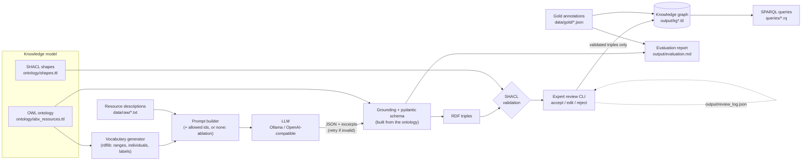

# Ontology-guided LLM metadata extraction

**Characterising antibiotic stewardship resources with an LLM guided by an OWL ontology,
with SHACL validation, SPARQL querying, human-in-the-loop review and evaluation.**

 


---

## Motivation

Antimicrobial resistance is a major public-health threat, and **antibiotic stewardship**
(the right antibiotic, only when needed, for the right duration) is a priority in nursing homes,
where residents are frail, infections are frequent and prescriptions are often empirical.
Many resources exist to support care teams: posters, practical sheets, trainings, videos and tools.
They are scattered, though, and described inconsistently, which makes them hard to find
("what is there for *care assistants* about *urinary tract infections*?").

This project is a small but complete **knowledge-engineering pipeline** for that problem:

1. an **OWL ontology** formalises how a resource is characterised (audience, objective, topic, format, usage conditions);
2. an **LLM** reads a free-text description and proposes metadata, **constrained by the ontology**
   (the vocabulary is generated from the OWL file and injected in the prompt, and the output is validated against it);
3. **SHACL** checks the resulting RDF records, and a **domain expert validates** every value with its source excerpt;
4. validated records feed a **knowledge graph** queried with **SPARQL**;
5. an **evaluation** measures quality and answers the key research question:
   *does ontology guidance in the prompt improve the extraction?* (ablation guided vs unguided).

## Architecture



| Module | Role |
|---|---|
| `src/vocabulary.py` | Reads the ontology with rdflib and generates the allowed values of each field (range classes → individuals, EN/FR labels, `skos:altLabel`s). Nothing is hard-coded. |
| `src/schema.py` | Builds a **pydantic** model at runtime whose controlled fields are `Literal[<ontology ids>]`. |
| `src/llm.py` | LLM clients: **Ollama** (default, local), any **OpenAI-compatible** API, and an offline `mock`. |
| `src/extract.py` | Prompt → LLM → JSON parsing → grounding → pydantic → RDF → SHACL; retries on invalid JSON / out-of-ontology values; keeps a source excerpt per value. |
| `src/review.py` | Human-in-the-loop CLI; only SHACL-conformant, expert-validated records enter the KG; decisions logged. |
| `src/evaluate.py` | P/R/F1 per property, out-of-ontology rate, SHACL conformance, faithfulness; guided vs unguided. |
| `src/build_graph.py`, `src/query.py` | Gold → `output/kg.ttl`; runs the SPARQL queries and prints tables. |
| `src/validate.py` | SHACL validation (pyshacl) of any Turtle file. |

## Ontology overview

`ontology/abx_resources.ttl`, an OWL 2 ontology in Turtle, namespace
`https://eya-lakhal.github.io/ontology-guided-llm-metadata/abx#` (prefix `abx:`), every entity labelled in **English and French**.

| Dimension | Classes | Individuals (controlled vocabulary) |
|---|---|---|
| `Resource` | `Poster`, `PracticalSheet`, `Training`, `Video`, `Tool` (pairwise disjoint) | n/a (resources are data) |
| `TargetAudience` | `HealthProfessional` ⊃ {`Nurse`, `Physician`, `CareAssistant`, `Pharmacist`}, `Resident`, `Family` | `nurse`, `physician`, `care_assistant`, `pharmacist`, `resident`, `family` |
| `Topic` | `Infection` ⊃ {`UrinaryTractInfection`, `RespiratoryInfection`}, `AntibioticResistance`, `HandHygiene`, `Prescription`, `Vaccination` | `uti`, `respiratory_infection`, `antibiotic_resistance`, `hand_hygiene`, `prescription`, `vaccination` |
| `Objective` | n/a | `raise_awareness`, `improve_diagnosis`, `reduce_unnecessary_prescription`, `improve_prescription_quality`, `prevent_infection`, `train_staff` |
| `Format` | n/a | `print`, `pdf`, `elearning`, `face_to_face`, `video_file`, `web_app` |
| `UsageCondition` | n/a | `free_access`, `registration_required`, `trainer_required`, `open_licence`, `professional_use_only` |

- **Object properties** (domain `Resource`): `hasTargetAudience`, `hasObjective`, `coversTopic`,
  `hasFormat` (functional), `hasUsageCondition`, `relatedTo` (symmetric).
- **Data properties**: `title`, `publicationYear` (xsd:integer, functional), `publisher`, `language`, `url` (xsd:anyURI).
- **SHACL** (`ontology/shapes.ttl`): each `Resource` has exactly 1 title, ≥ 1 target audience, ≥ 1 topic,
  exactly 1 format; every value must be an instance of the right ontology class; language ∈ {fr, en}.
  Validation merges the ontology into the data graph **without RDFS inference**. Otherwise `rdfs:range`
  would "repair" wrongly typed values, e.g. inferring that `abx:pdf` is a `Topic`.

### Opening and checking it in Protégé

1. Install [Protégé](https://protege.stanford.edu/) 5.6+.
2. *File → Open…* and select `ontology/abx_resources.ttl`.
3. Browse the *Classes*, *Object properties*, *Data properties* and *Individuals* tabs.
   Tip: *View → Render by label (rdfs:label)* shows the human-readable labels.
4. *Reasoner → HermiT*, then *Reasoner → Start reasoner*. The ontology should be **consistent**
   and no class should appear under `owl:Nothing` in the inferred hierarchy.
   Individuals are then classified, e.g. `abx:nurse` is inferred to be a `HealthProfessional` and a `TargetAudience`.
5. Optional: open `ontology/examples.ttl` too (*File → Open*, then merge) to see two example resources.

## Dataset

> ⚠️ **All data in `data/` is synthetic.** The 10 resource descriptions were written for this project:
> they are realistic in style but the resources, publishers (e.g. "CRAPI Grand-Est", "Northfield Infection
> Prevention Network") and dates are invented. They contain no real patient or institutional data.

- `data/raw/rXX.txt`: plain-text description of one resource (6 in French, 4 in English), first line = title.
- `data/gold/rXX.json`: expected annotation, using only identifiers defined in the ontology:

```json
{
  "id": "r01", "resource_type": "Poster", "title": "Bandelette urinaire en EHPAD : pas de dépistage systématique",
  "publisher": "CRAPI Grand-Est", "publication_year": 2023, "language": "fr",
  "target_audience": ["care_assistant", "nurse"],
  "objective": ["reduce_unnecessary_prescription", "improve_diagnosis"],
  "topic": ["uti"], "format": "print", "usage_condition": ["free_access"], "related_to": ["r05"]
}
```

## How to run (Windows PowerShell)

```powershell
git clone https://github.com/eya-lakhal/ontology-guided-llm-metadata.git
cd ontology-guided-llm-metadata
python -m venv .venv
.\.venv\Scripts\Activate.ps1
pip install -r requirements.txt
Copy-Item .env.example .env
```

**LLM backend.** By default the project uses [Ollama](https://ollama.com/) locally:

```powershell
ollama pull llama3.1:8b        # or: ollama pull qwen2.5:7b
ollama serve                   # if not already running
```

To use an OpenAI-compatible API instead, edit `.env`:
`LLM_PROVIDER=openai`, `LLM_MODEL=gpt-4o-mini`, `LLM_API_KEY=...`, `LLM_BASE_URL=https://api.openai.com/v1`.
Every command also accepts `--provider mock` to run fully offline, with a deterministic rule-based stand-in.

**Pipeline.**

```powershell
pytest                                          # 118 tests, no LLM or network needed
python -m src.validate                          # SHACL check of ontology/examples.ttl
python -m src.build_graph                       # gold annotations -> output/kg.ttl
python -m src.query                             # run all SPARQL queries in queries/
python -m src.extract --all                     # LLM proposals -> output/proposals/guided/
python -m src.extract --all --no-guidance       # ablation      -> output/proposals/unguided/
python -m src.review --reviewer "Eya"           # expert review -> output/kg_reviewed.ttl + output/review_log.json
python -m src.evaluate --cached                 # report        -> output/evaluation.md
```

`python -m src.extract data/raw/r01.txt --show-prompt` prints the exact prompt sent to the model.

### Human-in-the-loop review

```text
  topic: 'uti' (Urinary tract infection / Infection urinaire)
    excerpt: "La bactériurie asymptomatique ne doit pas être traitée par antibiotique"  ✓ found in source
    [a]ccept / [e]dit / [r]eject ? a
  add a value to topic? (identifier or label, empty = no) Antibiorésistance
  ...
  SHACL: conforms
  -> added to output/kg_reviewed.ttl; logged in output/review_log.json
```

Edited or added values must resolve to an ontology identifier (labels in EN/FR are accepted);
a record that violates the SHACL shapes (e.g. all topics rejected) is **not** added to the knowledge graph.

## Example SPARQL query

Resources about **any kind of infection**. The query walks the topic hierarchy
(`UrinaryTractInfection` and `RespiratoryInfection` are subclasses of `Infection`):

```sparql
PREFIX abx:  <https://eya-lakhal.github.io/ontology-guided-llm-metadata/abx#>
PREFIX rdfs: <http://www.w3.org/2000/01/rdf-schema#>

SELECT ?resource ?title (GROUP_CONCAT(DISTINCT ?topicLabel; separator=", ") AS ?infections)
WHERE {
  ?resource abx:title ?title ; abx:coversTopic ?t .
  ?t a/rdfs:subClassOf* abx:Infection ; rdfs:label ?topicLabel .
  FILTER(lang(?topicLabel) = "en")
}
GROUP BY ?resource ?title
ORDER BY ?resource
```

| resource | title | infections |
|---|---|---|
| abxd:r01 | Bandelette urinaire en EHPAD : pas de dépistage systématique | Urinary tract infection |
| abxd:r05 | UTI Check: decision support for suspected urinary tract infection | Urinary tract infection |
| abxd:r07 | Flu season: protect yourself, protect your residents | Respiratory infection |
| abxd:r08 | Durées de traitement antibiotique : fiche mémo pour l'officine | Urinary tract infection, Respiratory infection |
| abxd:r10 | Pneumopathie chez le résident : quand l'évoquer, que faire ? | Respiratory infection |

Other queries in `queries/`: resources for nurses about UTI, count per topic, resources missing a
usage condition (curation backlog), resources per audience with French labels, related resource pairs
(symmetric property), recent French resources for health professionals.

## Evaluation

`python -m src.evaluate` runs both conditions on the 10 documents and writes `output/evaluation.md`:

| Metric | Guided (ontology in prompt) | Unguided | Δ |
|---|---:|---:|---:|
| Micro-F1, controlled properties | 98.3% | 73.8% | +24.5 pts |
| Micro-precision | 96.7% | 96.3% | +0.4 pts |
| Micro-recall | 100.0% | 59.8% | +40.2 pts |
| Out-of-ontology values (before validation) ↓ | 0.0% | 40.0% | −40.0 pts |
| SHACL-conformant records | 100.0% | 80.0% | +20.0 pts |
| Faithful excerpts | 100.0% | 100.0% | 0 |

> ⚠️ **These figures come from the offline `mock` provider**, a keyword matcher whose lexicon was
> written alongside the synthetic data. They validate the evaluation machinery and show the expected
> *shape* of the ablation: without the vocabulary, the model answers in its own terms ("Nursing assistants",
> "fact sheet", "Staff education"), which cannot be grounded to the ontology, so recall and SHACL
> conformance fall. They are **not LLM results**. Reproduce with a real model:
> `python -m src.evaluate --provider ollama --model llama3.1:8b` (or `qwen2.5:7b`).

Metrics: per-property P/R/F1 (set comparison per document, micro-averaged); out-of-ontology rate on the
model's first parsable answer; schema-valid rate and number of retries; SHACL conformance of the produced
RDF; **faithfulness**, meaning the justification excerpt is found verbatim in the source text.

## Limitations

- **Tiny, synthetic corpus** (10 documents written by the author): no statistical significance, and a risk
  of the ontology, gold and descriptions being too well aligned.
- The ontology is a **first draft written alone**, not validated by stewardship experts; the objective and
  usage-condition dimensions in particular would need co-construction.
- Gold annotations come from a single annotator, with no inter-annotator agreement.
- Faithfulness is a **lexical** check (is the excerpt in the text?), not an entailment check (does the
  excerpt really support the value?).
- The grounding step tolerates labels, alternative labels, accents and plurals, which helps the unguided
  condition. The ablation measures the effect of the prompt alone, with the same post-processing.

## Future work

- **Ontology co-construction with experts** (infectiologists, coordinating nurses, pharmacists), through
  iterative workshops and competency questions turned into SPARQL tests.
- **Larger, real corpus**: public stewardship resources (posters, PDFs, training catalogues) with
  PDF/OCR ingestion, and several annotators for inter-annotator agreement.
- **Ontology alignment** with existing vocabularies: MeSH / SNOMED CT for topics, schema.org / LRMI
  (`educationalAudience`, `learningResourceType`) and Dublin Core for resource metadata.
- Use the expert decisions logged by the review tool as feedback: few-shot examples, active learning,
  and proposals to **extend the ontology** when the model repeatedly suggests a missing concept.
- Constrained decoding (JSON schema / grammar) and comparison of several open LLMs; entailment-based
  faithfulness (NLI).

## Repository layout

```text
ontology/   abx_resources.ttl (OWL), shapes.ttl (SHACL), examples.ttl
data/       raw/ (synthetic descriptions), gold/ (expected annotations)
queries/    *.rq SPARQL queries
src/        vocabulary, schema, llm, extract, review, evaluate, build_graph, query, validate
tests/      pytest suite (runs offline with the mock provider)
output/     kg.ttl, evaluation.md (+ generated proposals, review log)
```

## License

MIT, © 2026 Eya Lakhal.
